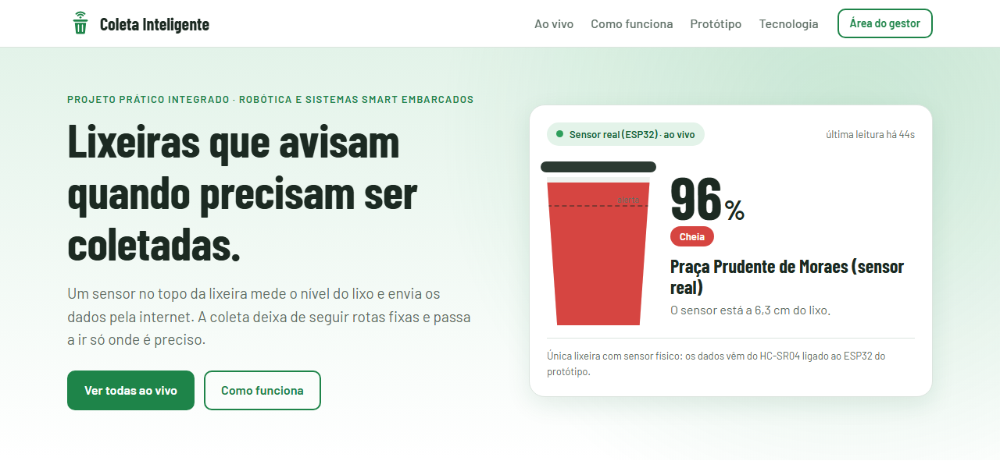
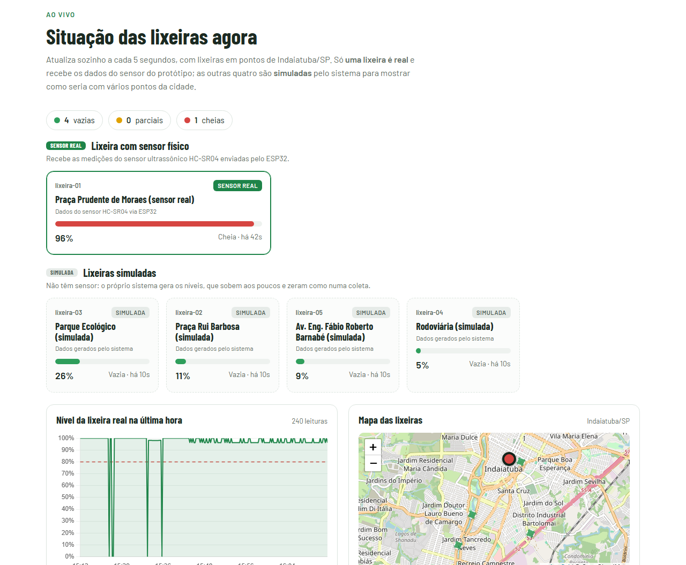
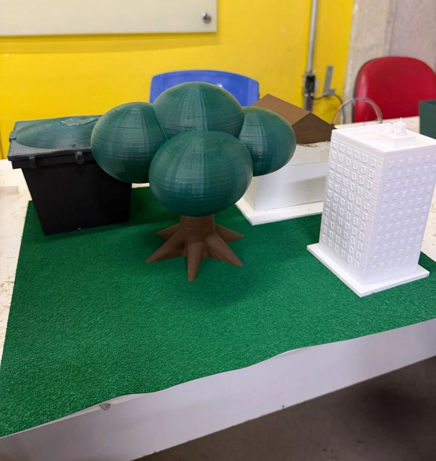
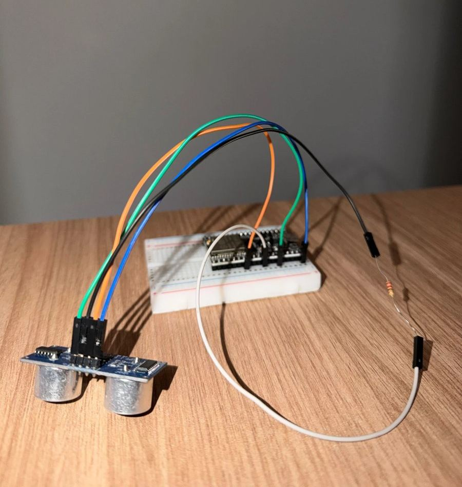
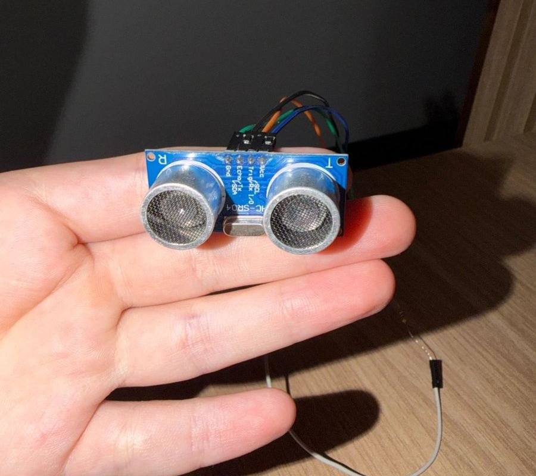
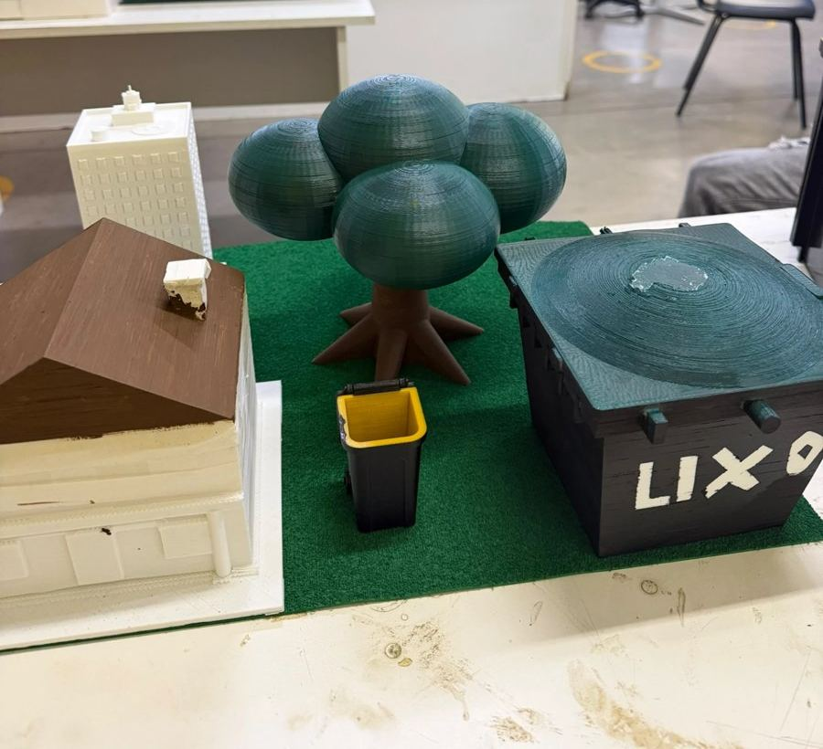
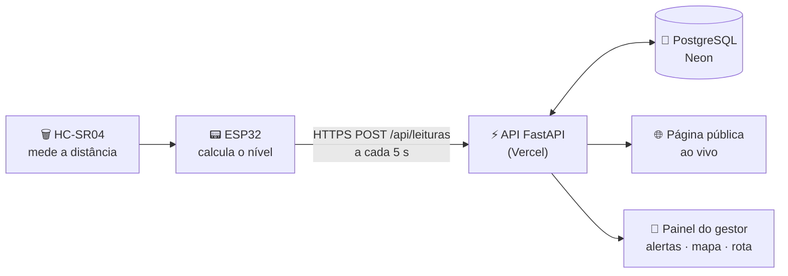

<div align="center">


# Coleta Inteligente

**Lixeiras que avisam quando precisam ser coletadas.**

Um sensor no topo da lixeira mede o nível do lixo, um ESP32 envia a medição pela internet
e um painel web mostra, ao vivo, onde a coleta realmente é necessária.

[](https://coleta-inteligente-seven.vercel.app)


Projeto Prático Integrado · Robótica e Sistemas Smart Embarcados – IoT · **UNIMAX**

</div>

---

<p align="center">
  
</p>

## 💡 A ideia

Hoje o caminhão de lixo segue **rotas e horários fixos**, sem saber quanto cada lixeira tem. Ele passa em lixeiras
quase vazias enquanto outras transbordam antes da próxima coleta — gastando combustível, tempo e deixando a cidade
mais suja.

O **Coleta Inteligente** coloca um sensor em cada lixeira. O nível chega à nuvem a cada poucos segundos, o gestor vê
no painel quais estão cheias, recebe alertas e monta a rota **só com as lixeiras que precisam ser coletadas**.

> 🌱 Alinhado aos ODS **11** (Cidades e comunidades sustentáveis) e **12** (Consumo e produção responsáveis).

## ✨ Funcionalidades

| | |
|---|---|
| 📡 **Medição em tempo real** | HC-SR04 mede a distância até o lixo; o ESP32 envia a cada 5 s por Wi-Fi (HTTPS) |
| 🌐 **Página pública ao vivo** | qualquer pessoa acompanha pelo celular, sem login — com QR code para a feira |
| 🚦 **Status por cores** | verde até 50%, amarelo até 80%, vermelho acima — padrão semáforo |
| 🔔 **Alertas** | lixeiras acima do limite configurável (padrão 80%), ordenadas por prioridade |
| 📈 **Histórico** | gráfico do nível ao longo do tempo (7 dias guardados) |
| 🗺️ **Mapa e rota** | localização das lixeiras e prévia da rota de coleta (vizinho mais próximo) |
| 🔐 **Painel do gestor** | login com senha criptografada, cadastro e edição de lixeiras |
| 📴 **Modo offline** | roda no notebook sem internet, com banco local — plano B para apresentações |

## 📸 Ao vivo

<p align="center">
  
</p>

**Real × simulado:** só a `lixeira-01` (Praça Prudente de Moraes) recebe dados do **sensor físico**. As outras quatro
são **simuladas** pelo servidor — o nível sobe aos poucos e zera perto de 100%, como numa coleta — para mostrar o
sistema com vários pontos de Indaiatuba/SP. Todas as telas identificam claramente qual é qual.

## 🔧 O protótipo

<table>
  <tr>
    <td align="center"><br><sub>Maquete 3D</sub></td>
    <td align="center"><br><sub>ESP32 + HC-SR04</sub></td>
    <td align="center"><br><sub>Sensor ultrassônico</sub></td>
    <td align="center"><br><sub>Cidade em escala</sub></td>
  </tr>
</table>

| Componente | Ligação |
|---|---|
| ESP32 DevKit | microcontrolador com Wi-Fi |
| HC-SR04 `TRIG` | GPIO 32 |
| HC-SR04 `ECHO` | GPIO 27, via **divisor de tensão** (5 V → 3,3 V) |
| Alimentação | USB 5 V |

O sensor fica na tampa da lixeira, apontado para baixo. O Wi-Fi e o endereço do servidor são configurados pelo
celular, num portal criado pelo próprio ESP32 (**WiFiManager**) — sem precisar regravar o código.

## ⚙️ Como funciona



```
nível = (altura − distância) ÷ altura × 100
```
*Ex.: lixeira de 100 cm com o lixo a 30 cm do sensor → 70% cheia.*

## 🛠️ Tecnologias

| Camada | Tecnologias |
|---|---|
| **Hardware** | ESP32, sensor ultrassônico HC-SR04, divisor de tensão |
| **Firmware** | C++ / Arduino, WiFiManager, HTTPClient, WiFiClientSecure, Preferences |
| **Back-end** | Python, FastAPI, Uvicorn, Pydantic |
| **Banco de dados** | PostgreSQL no Neon (online) · SQLite (offline e testes) |
| **Front-end** | HTML, CSS e JavaScript puro, Chart.js, Leaflet + OpenStreetMap |
| **Infraestrutura** | Vercel (funções Python + CDN, HTTPS) |
| **Qualidade** | pytest (44 testes), cabeçalhos de segurança (CSP), proteção contra força bruta |

## 🚀 Rodando localmente

Pré-requisito: **Python 3.10+**.

```bash
git clone https://github.com/joaomarigo/coleta-inteligente.git
cd coleta-inteligente
pip install -r requirements.txt
```

**Sem internet / para testar** (banco SQLite local, criado automaticamente):

```bash
python gerenciar.py gestor --email voce@exemplo.com --offline
python gerenciar.py iniciar --offline
```

Abra **http://localhost:8000** (página pública) e **http://localhost:8000/painel** (gestor). O comando também mostra o
endereço para celulares e para o ESP32 na mesma rede Wi-Fi.

**Com o banco online (Neon):** defina `DATABASE_URL` (veja [`.env.example`](.env.example)) — em projetos ligados ao
Vercel, `vercel env pull` cria o `.env.local` — e rode `python gerenciar.py iniciar`.

<details>
<summary><b>Outros comandos do <code>gerenciar.py</code></b></summary>

| Comando | O que faz |
|---|---|
| `python gerenciar.py verificar [--offline]` | confere Python, pacotes, arquivos, banco, gestor e sensor |
| `python gerenciar.py iniciar [--offline] [--porta 8000]` | inicia o servidor na rede local |
| `python gerenciar.py gestor --email E [--offline]` | cria o gestor ou troca a senha |
| `python gerenciar.py demo [--offline]` | gera um histórico novo para as lixeiras simuladas |
| `python gerenciar.py preparar-offline` | copia os dados do banco online para o arquivo local |
| `python gerenciar.py backup [--offline]` | exporta lixeiras, configurações e leituras em JSON |

</details>

<details>
<summary><b>Variáveis de ambiente</b></summary>

| Variável | Obrigatória | Para quê |
|---|---|---|
| `DATABASE_URL` | sim | `postgresql://...` (Neon) ou `sqlite:///coleta_local.db` |
| `COLETA_ADMIN_EMAIL` | não | e-mail do gestor criado automaticamente (padrão `admin@coleta.local`) |
| `COLETA_ADMIN_SENHA` | não | se o banco não tiver gestor, cria um com esta senha |
| `COLETA_TOKEN_DISPOSITIVO` | não | exige que o ESP32 envie este token no cabeçalho `X-Token-Dispositivo` |

</details>

<details>
<summary><b>Gravando o ESP32</b></summary>

1. Arduino IDE com o pacote **esp32** (Espressif) e a biblioteca **WiFiManager** (tzapu).
2. Abra `coleta_inteligente_esp32/coleta_inteligente_esp32.ino`, placa **ESP32 Dev Module**, e grave.
   Se aparecer *“Wrong boot mode”*, segure **BOOT** durante o `Connecting...`.
3. Com o ESP32 ligado, segure **BOOT por 3 s**: ele cria a rede `ColetaInteligente-Config`.
4. Conecte o celular, escolha o Wi-Fi e informe o servidor — o endereço do site (HTTPS) ou `IP-do-computador:8000`.
5. No Serial Monitor (115200): `Envio OK, codigo HTTP: 200`.

</details>

## 🧪 Testes

```bash
pip install -r requirements-dev.txt
python -m pytest -q
```

Os testes usam um banco SQLite temporário (sem internet) e cobrem as regras de negócio (cálculo do nível, faixas de
cor, sensor offline, alertas), o envio de leituras, login e permissões, o cadastro de lixeiras, a API pública e os
cabeçalhos de segurança.

## 📁 Estrutura

```
├── main.py            API: rotas, regras de negócio, simulação e segurança
├── auth.py            senhas, sessões e bloqueio de tentativas de login
├── database.py        PostgreSQL (pool) ou SQLite, tabelas e dados iniciais
├── gerenciar.py       ferramentas de linha de comando
├── coleta_inteligente_esp32/   firmware do ESP32
├── static/            página pública, painel do gestor, imagens e bibliotecas
├── tests/             testes automatizados
└── docs/img/          imagens deste README
```

## 🔒 Segurança

Senhas com PBKDF2-SHA256 · sessão em cookie `HttpOnly`/`SameSite` com token guardado só como hash · bloqueio após
várias tentativas de login · validação de todas as entradas · SQL parametrizado · Content-Security-Policy e demais
cabeçalhos de segurança · API pública só com dados de exibição · token opcional para o dispositivo.

## 🧭 Próximos passos

- Substituir as lixeiras simuladas por mais sensores físicos
- Rota otimizada considerando trânsito e capacidade do caminhão
- Notificações por e-mail, Telegram ou WhatsApp
- Alimentação por bateria/solar com *deep sleep* e sensor à prova d’água (JSN-SR04T)
- Previsão de enchimento com base no histórico

---

<div align="center">

Feito para o **Projeto Prático Integrado** da **UNIMAX** · Robótica e Sistemas Smart Embarcados – IoT

<sub>Bibliotecas de terceiros e suas licenças: <a href="static/vendor/LICENCAS.md">static/vendor/LICENCAS.md</a></sub>

</div>
